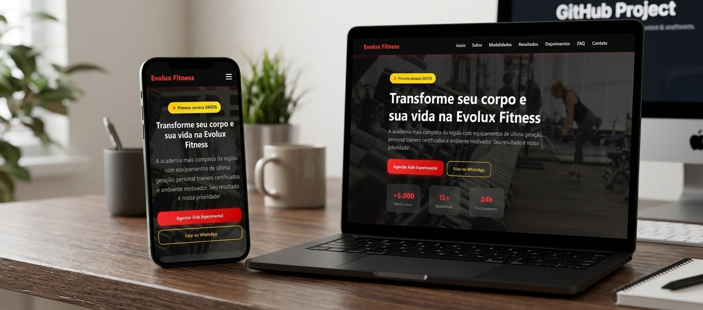

  <h1>🏋️ Evolux Fitness</h1>

<h2> Site institucional de uma academia fictícia, utilizado como projeto de estudo e portfólio Front-End.</h2>

## 🚀 Tecnologias

- HTML5
- CSS3
- JavaScript

## ✨ Funcionalidades

- Layout responsivo.
- Menu de navegação para dispositivos móveis.
- Navegação com rolagem suave.
- FAQ interativo.
- Animações durante a rolagem.
- Botões de contato via WhatsApp.
- Redirecionamento para o Google Maps.

## 💻 Como executar

1. Clone este repositório.
2. Abra a pasta no Visual Studio Code.
3. Abra o arquivo index.html no navegador.

## 📌 Observação

Projeto para fins educacionais. Marca, endereço, depoimentos e demais informações são fictícios.
 
 
 

  
**Evolux Fitness © 2026**

